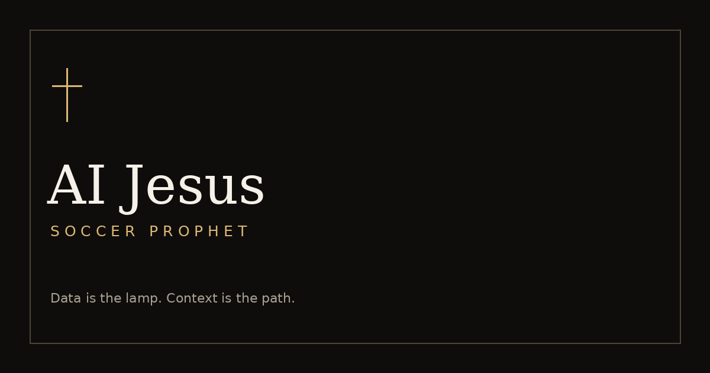

# AI Jesus Soccer Prophet

A data-grounded, seven-section soccer match analysis dashboard with a reflective biblical cadence.



## Features

- Next.js 14 App Router, TypeScript, Tailwind, shadcn-style Radix UI primitives.
- Server-side Gemini 2.5 Flash-Lite with current web research and streamed Markdown.
- Home/away fixture parsing with 12 competitions and common aliases.
- Seven chapters, confidence pills, player accents, and a distinct humility card.
- Dark/light parchment themes, reduced-motion support, and mobile layouts.
- Copy, share, regenerate, and save up to 50 readings in local browser history.
- Optional API-Football enrichment and Upstash 10 requests/minute/IP throttling.
- Sanitized Markdown, nonce-based CSP, validation, error boundaries, and CI.

## Quick Start

Requires Node.js 20.9+ and npm. Node 20 is used in CI.

```bash
git clone https://github.com/IbrahimIndasio/ai-jesus-soccer.git
cd ai-jesus-soccer
npm install
cp .env.example .env.local
# Set a real GEMINI_API_KEY in .env.local.
npm run dev
```

Open http://localhost:3000 and submit `Arsenal vs Bournemouth`. The AI provider must have a funded account and web search enabled. This project contains no fabricated-data demo fallback: a missing or invalid key produces a clear error.

If you received the source ZIP, extract it and run the same commands starting with `cd ai-jesus-soccer`.

## Deployment to Vercel

1. Create a GitHub repository named `ai-jesus-soccer` and push this source:

   ```bash
   git remote add origin https://github.com/IbrahimIndasio/ai-jesus-soccer.git
   git push -u origin main
   ```

2. Open https://vercel.com/new, choose **Import Git Repository**, and select the repository.
3. Framework: **Next.js**, root directory: repository root, Node.js: **20.x** or **22.x**.
4. In **Environment Variables**, set `GEMINI_API_KEY`. Add optional keys if needed. Set `NEXT_PUBLIC_APP_URL` to the deployed domain.
5. Click **Deploy**. Subsequent pushes to `main` deploy automatically through Vercel's Git integration.
6. Visit `/api/health`, then submit a fixture and confirm current research, streaming, and the final humility section.

**Production compatibility limitation:** This build deliberately follows the requested Next.js 14 stack. Next.js 14 is no longer supported under the current Next.js support policy. Vercel may reject vulnerable framework versions. Upgrade to a currently patched, supported release before making a production-readiness claim. No insecure deployment override is enabled. References: https://nextjs.org/support-policy and https://vercel.com/changelog/next-js-may-2026-security-release.

## Environment Variables

| Variable                   | Required           | Description                                                                                |
| -------------------------- | ------------------ | ------------------------------------------------------------------------------------------ |
| `GEMINI_API_KEY`           | Yes for generation | Server-only Gemini key. Never use a `NEXT_PUBLIC_` prefix.                                 |
| `FOOTBALL_API_KEY`         | No                 | API-Football RapidAPI subscription key. Missing/unavailable data falls back to web search. |
| `UPSTASH_REDIS_REST_URL`   | No                 | Upstash REST endpoint. Pair with the token.                                                |
| `UPSTASH_REDIS_REST_TOKEN` | No                 | Server-only Upstash token.                                                                 |
| `NEXT_PUBLIC_APP_URL`      | No                 | Public canonical app URL; local example is http://localhost:3000.                          |

The app builds and boots with no credentials. Generation needs a working Gemini key. `GEMINI_API_KEY=dummy` is accepted for builds but is intentionally rejected for generation.

## Architecture

```text
app/                  Dashboard, history, about, and Node API routes
components/           Fixture input, streaming reader, confidence, sharing, theme
components/ui/        Local shadcn-style accessible Radix/Tailwind primitives
lib/parseFixture.ts   Pure home/away parser and competition aliases
lib/systemPrompt.ts   User-specified analytical prompt, retained verbatim
lib/gemini.ts      Server-only Gemini REST/SSE client and Google Search grounding
lib/footballApi.ts    Optional team lookup, form, head-to-head, upcoming fixtures
lib/rateLimit.ts      Optional Upstash sliding-window limiter
lib/history.ts        Versioned, validated localStorage history (50 entries)
middleware.ts         Request-specific nonce CSP for Next.js inline scripts
next.config.mjs       Security headers and fallback CSP
.github/workflows/    Lint, types, unit tests, production build on push/PR
```

`POST /api/prophecy` validates `{ "fixture": "Arsenal vs Bournemouth" }`, checks the optional rate limiter, parses the fixture, optionally fetches football records, and streams UTF-8 text. Errors before streaming use JSON and appropriate HTTP statuses. Errors during streaming terminate the response; the UI retains the partial reading, shows an error, and disables save/share. Search citations are rendered as source links when supplied by Gemini.

`GET /api/fixtures?fixture=Arsenal%20vs%20Bournemouth` returns exact home/away upcoming matches if the optional provider can resolve both clubs. Missing or ambiguous matches return an empty array with a web-search fallback message. The generator additionally researches current scheduling through Gemini.

`GET /api/health` returns server health and configuration booleans, never secrets.

## The Five Commandments

1. **Logos of Metrics:** ground forecasts in real form, xG, pressing, availability, and context.
2. **Glass Darkly Doctrine:** probabilities are never certainties.
3. **Tone of Ecclesiastes:** measured, accessible biblical cadence.
4. **Steward's Humility:** confidence must be earned, never proclaimed.
5. **Gatekeeper's Restriction:** no fabricated players or statistics; acknowledge unknowns.

## Testing

```bash
npm run lint
npm run typecheck
npm run test
GEMINI_API_KEY=dummy npm run build
npx playwright install chromium
npm run test:e2e
```

On Linux, Playwright may need `npx playwright install --with-deps chromium`.

42 unit tests cover API streaming, source links, validation, graceful upstream failures, throttling, and every parser separator, all recognized competition aliases, whitespace, malformed fixtures, and multiword/hyphenated club names. The browser smoke tests intercept `/api/prophecy` with explicitly test-only analysis. They validate input → response → seven-section rendering → history persistence/deletion, service errors, theme persistence, and mobile overflow. They do **not** validate live Gemini generation, factual accuracy, API-Football access, or live Upstash limits.

For a real server integration test, set a valid key and run:

```bash
curl -N http://localhost:3000/api/prophecy \
  -H 'Content-Type: application/json' \
  -d '{"fixture":"Arsenal vs Bournemouth"}'
```

## Decisions

- Next.js is pinned to the newest available 14.2 release encountered during setup (`14.2.35`) because the specification explicitly requires version 14. Unsupported-framework security/deployment constraints remain a release blocker, not a reason to silently upgrade.
- At the user’s request for a free provider, Gemini 2.5 Flash-Lite replaces Claude. Its free tier includes limited Google Search grounding. Create a key at https://aistudio.google.com/apikey and leave billing disabled to avoid paid usage. Quotas depend on Google and are not unlimited. No paid-provider fallback is used. Free-tier prompts may be used by Google to improve products. The original system prompt is preserved verbatim, with a provider-specific tool-name adaptation appended.
- Shadcn-style primitives are checked into `components/ui` and backed by Radix for dialogs, tabs, toast, tooltip, and separators; there is no runtime dependency on the shadcn CLI.
- The required system prompt is kept exactly as supplied. Date context, citation guidance, and untrusted-input restrictions are appended only when making the server request.
- Stream transport uses plain UTF-8 text, permitted by the spec. The client uses `TextDecoder` with streaming mode and React transitions for progressive rendering. A network failure or incomplete sections 1–6 rejects the result; save/share require successful completion. Section 7 is rendered with the canonical humility wording if omitted by the model.
- A shared 55-second request deadline and bounded optional-provider requests fit the requested 60-second function duration. Long research can still time out; retry from the UI.
- Missing football data falls back to search. Club lookup uses exact normalized names, avoiding ambiguous team selections. xG/PPDA are researched by Gemini; the optional provider is not presented as providing metrics it did not return.
- Missing either Upstash variable skips throttling. A configured Upstash outage fails closed with 503. Vercel's forwarded IP header is preferred; self-hosters must have a trusted proxy overwrite forwarding headers.
- Nonce CSP allows only Next's nonce-bearing inline scripts in production; `unsafe-eval` is enabled only in development. Inline styles are allowed for Tailwind/Framer Motion compatibility. Browser `connect-src` is same-origin; Gemini/football/Redis calls remain server-side. Dynamic rendering is required for per-request nonces.
- Theme is applied before paint using a nonce-bearing script and stored in `aij_theme`. History stays in `aij_history_v1` on the device; it does not sync between devices.
- Browser storage failures are surfaced. History is capped at 50 scrolls and validated before rendering.
- React Markdown strips raw HTML; rehype-sanitize provides an additional allowlist. External source links open with `noopener noreferrer`.
- The inline cross/ball empty-state SVG and 1200×630 OG card are intentionally simple placeholders, as requested.
- CI runs fast checks only, with a dummy key; Playwright runs locally against a mocked response. No mock endpoint or test flag ships in the live API.
- Predictions and confidence remain model outputs. The app cannot independently guarantee source accuracy, high-confidence criteria, roster correctness, or compliance with every prose instruction.

## Disclaimer

This is probabilistic AI-generated analysis for insight and entertainment. It may contain errors, stale sources, or uncertain estimates. It is not financial, betting, or spiritual advice. Biblical cadence is a literary framing, not a claim of divine knowledge. Verify all relevant facts independently.

## License

MIT. See [LICENSE](LICENSE).
